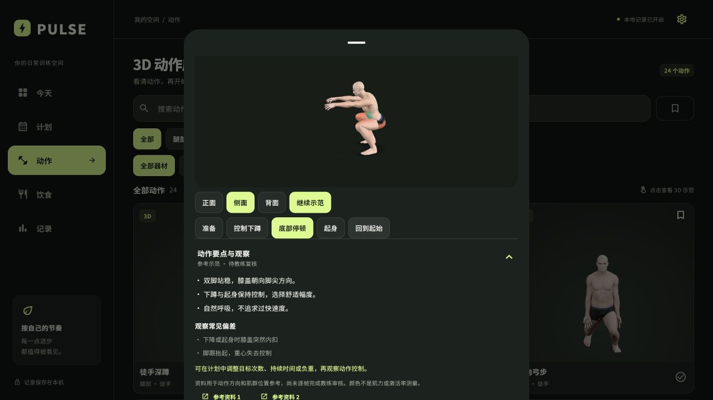
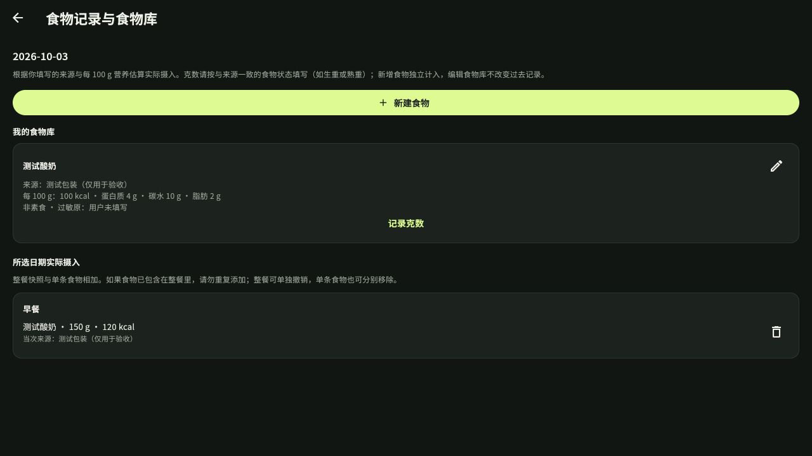
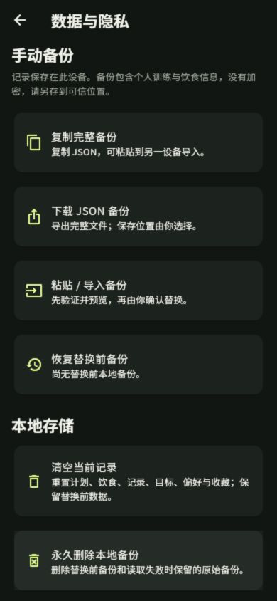
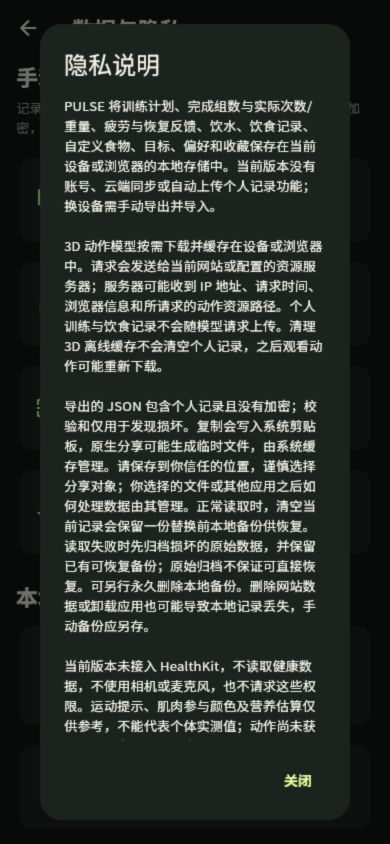

# 六项完善交付记录 · 2026-10-03

本次范围是现有 Flutter 应用的六项完善。软件改动、自动测试和本地网页验收已完成；教练审核、iPhone 真机验收和生产资源部署仍为独立待办。保留原始 MAX、FBX、Blender 源及 24 个 GLB，没有重建骨架或修改已认可的动作字节。本次未公开部署、购买订阅或上传 App Store。

## 实际交付

| 项目 | 当前行为 | 验证与限制 |
| --- | --- | --- |
| 动作教学与专业复核流程 | 24 个动作都有要点、常见偏差、资料来源和待复核标记；分阶段暂停，正/侧/背面观察；提供审核人、资质、日期、证据、结论的离线验收表 | 全目录覆盖测试、阶段控制回归通过。尚无已识别教练的逐帧审核，不标记认证；肌肉颜色是参与示意，不是受力/肌电测量 |
| 模型传输与缓存 | 深蹲/俯卧撑内置，其余 22 个按需下载；真实字节进度，压缩文件与原始模型双重 SHA-256 校验，超时、取消、重试、缓存清理 | 24 个压缩文件解压后与原始字节一致；损坏、缓存失败、下载切换和总超时测试通过。未配置原生资源主机时明确提示并提供视频 |
| iPhone 稳定性准备 | 训练计时、3D、备用视频切后台暂停，回到前台需主动继续；24 个本地 H.264 视频作为 3D 失败时的轻量示范 | 320/390px 布局与生命周期回归通过；视频异步播放/切后台竞态有回归。真正 iPhone 帧率、温升、内存、锁屏和系统分享未实测 |
| 实际训练及恢复建议 | 逐组记录实际次数或持续秒数、重量；“仅完成”保留缺失值，不把计时器当实际训练量；睡眠、酸痛、疼痛反馈；调整建议展示依据 | 重复组、旧数据、记录持久化、实际与耗时分离、恢复降量及相关动作渐进条件均有测试 |
| 自定义食物与摄入 | 食物名称、来源、每 100g 数值、忌口/素食；按克数记录到餐次；历史摄入保存独立快照；饮食建议比较热量与多种宏量营养目标 | 150g × 80kcal/100g = 120kcal；把食物库改为 100kcal/100g 后旧摄入仍为 120kcal。未来记录、忌口、历史快照、目标不被草稿覆盖均有测试 |
| 数据与隐私 | 五个页面均可打开设置；JSON 复制、网页下载请求、原生系统分享；严格校验与预览后再确认导入；保留覆盖前备份、失败回滚、明确清空/删除、隐私说明 | 损坏 JSON 拒绝；损坏本机记录先验证原始归档再恢复，保留已有有效备份；覆盖与回滚均用测试数据验证。手动备份，无云端/iCloud 自动同步；JSON 未加密 |

## 资源测量

- 原始 24 个模型：722,018,760 bytes（688.57 MiB）。
- 无损 gzip 传输总量：445,927,354 bytes（425.27 MiB），约减少 38.2%。
- 内置两个模型：74,209,888 bytes（70.77 MiB），相比全部内置的模型部分约减少 89.7%。这是模型部分大小，不是 iOS 安装包大小。
- 24 个备用视频：793,877 bytes（约 775 KiB），256×320、10 FPS、每个 6 秒；由未修改的原生动作源文件渲染。
- 单个模型仍可能较大（如死虫式压缩后约 42.69 MiB），真机连续切换与内存表现仍需验收。当前方案优先保留原动作几何，不声称已经完成模型减面或原生高性能渲染迁移。

机器可读证据：[模型无损校验](model-delivery-lossless.json)、[视频清单](fallback-videos.json)、[iOS 环境](ios-readiness.json)。

## 本次验证

| 命令 / 检查 | 实际结果 |
| --- | --- |
| `flutter test` | 148 项全部通过；日志 `.build/six-improvements/full-tests-final.log` |
| 首页和恢复对话框文案调整后的相关回归 | 20 项通过；日志 `.build/six-improvements/integration-touchup-tests.log` |
| `dart analyze lib test` | No issues found；日志 `.build/six-improvements/analyze-final.log` |
| Node 控制器与下载测试 | 12 项通过；日志 `.build/six-improvements/controller-final.log` |
| `python3 tools/prepare_model_delivery.py --verify` | 24 项通过，解压后原始 SHA-256 一致；日志 `.build/six-improvements/lossless-final.log` |
| `flutter build web --release` | 成功，最终编译 23.1 秒；日志 `.build/six-improvements/web-build-final.log` |
| `git diff --check` | 通过 |
| 本地浏览器 | 主页面 8879 刷新到最新构建，动作库 24 项；深蹲阶段暂停/侧面/教学卡验证。8880 测试 origin 验证食物新建、克数、历史快照、复制 JSON、拒绝损坏 JSON、有效导入预览及隐私弹窗；未在 8879 覆盖或清空个人记录 |
| 备用视频 | 浏览器逐项读取 24 个视频，均为 6 秒、256×320、无媒体错误；技术验证不代表动作专业审核 |

下载按钮已触发网页下载请求；内置浏览器的下载事件没有返回可核验文件路径，因此没有宣称文件已保存到指定位置。完整 JSON 复制与导入预览已在实际页面验证，原生分享调用通过测试接口验证；系统文件保存/分享仍要在 iPhone 上验收。

独立复核：训练实际数据与恢复逻辑、食物不可变快照与目标、模型缓存/播放器生命周期、备份校验/损坏恢复均已复核；已处理视频后台异步播放竞态和损坏存储无法恢复的问题。

## 仍需真实验收

1. **教练逐动作复核**：当前 24 项均为待复核。使用 `web/action-acceptance.html` 和 [验收说明](action-acceptance.md) 保存具名证据。
2. **iPhone 安装与设备表现**：本机只有 Command Line Tools，缺少完整 Xcode 与 CocoaPods。尝试 `flutter build ios --release --no-codesign` 返回 `Application not configured for iOS`，没有生成已验收安装包；Xcode 环境检查同时明确失败。按 [真机步骤](../ios-device-acceptance.md) 配置完整工具链、签名并执行测试。
3. **生产模型主机**：尚未选择/部署真实 HTTPS 资源服务。原生构建必须设置 `PULSE_ASSET_BASE_URL`，提供 `remote/models/*.glb.gz` 和适当 CORS；这些 gzip 文件不能再设置透明 `Content-Encoding: gzip`。本地 127.0.0.1 预览不等于公网部署。

## 页面证据

本地预览：[PULSE 应用](http://127.0.0.1:8879/)。
