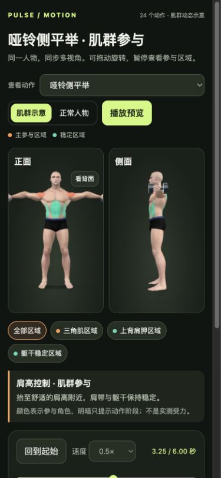
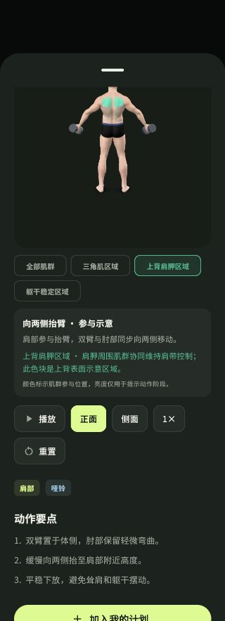

# 动作扩充后的缺陷审计

范围：当前 `exercise-review.html`、Flutter 动作详情、计划与跟练逻辑。确认 7 类问题：5 个 P2，2 个 P3。这是本轮已复现数量，不是整个应用的缺陷总数。产品代码和用户真实训练记录未修改。

## 1. P2 — 手机预览裁掉侧平举的双手与哑铃

复现：动作对照页，390×844 手机视口，选择「哑铃侧平举」，点击「3. 肩高控制」定位 3.25 秒，滚到双视图顶部。正面视图两侧均裁切，双手和哑铃不可见。

位置：`web/exercise-review.html:34-41,89-91`。页面计算了相机距离，但未配置 `max-camera-orbit`；本地 model-viewer 的默认最大距离由初始模型包围范围计算。相机计算测试没有覆盖实际组件约束，导致计算通过而实际画面仍被裁切。修复应同时处理实际相机限制和手机双栏布局，并以伸展峰值截图验收。

## 2. P2 — 混合训练被误判为以下肢为主

复现：完成俯卧撑、跪姿俯卧撑、弯举各 3 组，加深蹲 1 组（9 组上肢、1 组下肢）。下次安排仍解释为「最近训练以下肢为主」，并选择上肢与核心。

位置：`lib/core/app_state.dart:464-467`。使用 `any()` 将出现过下肢动作直接当作下肢占主导。应按已完成训练量判定，并为混合训练提供一致的解释和推荐。

## 3. P2 — 计划保存失败仍提示已保存

复现：隔离存储模拟拒绝写入。计划增加周二，点击保存后出现「训练计划已保存」，未保存状态被清除；重新载入后周二修改消失。

位置：`lib/screens/plan.dart:71-78`，`lib/core/app_state.dart:306-310`。保存函数吞下写入失败，调用方无条件清除 dirty 并返回成功。完整 App 另有保存错误横幅，因此是成功和失败提示互相矛盾，并非完全没有错误提示。应将保存结果传回调用方，失败时保留编辑状态。

## 4. P2 — 加入或替换动作后器材状态不一致

复现 A：默认徒手计划从动作库添加弯举，计划持久化后仍标记「徒手」，推荐继续排除哑铃动作。

复现 B：替换成普通划船会更新为「哑铃」；替换成需要「哑铃＋固定支撑台」的单臂划船却保留「徒手」。两个入口属于同一类器材同步缺陷。

位置：`lib/core/app_state.dart:322-332`，`lib/screens/workout.dart:52`。应统一动作变更后的器材处理，组合器材按 `requiredEquipment` 判断。

## 5. P2 — 已完成动作仍可进入不会记录的新一组

复现：计划包含 1 组深蹲和 2 组俯卧撑，深蹲已完成。跟练中点击「切换动作」再选深蹲，界面仍提供「完成本组」。再次训练并点击后，不增加完成组数或训练时间，却跳回下一动作并开始休息。

位置：`lib/screens/workout.dart:722-743,164-198`。选择列表允许已全部完成的动作；完成函数找不到未完成组仍继续切换及休息。应明确区分查看已完成动作和继续训练，避免把无法记录的动作呈现为待完成组。

## 6. P3 — 重新选择当前动作会清空本组计时

复现：当前组已计时，打开「切换动作」，点击已经带勾的当前动作。动作未变化，本组计时却归零，之前用时未写入训练日志。

位置：`lib/screens/workout.dart:734-743`。没有判断新旧索引相同，所有点击都执行 `watch.reset()`。重新选择当前动作应保留计时和休息状态。

## 7. P3 — 背面显示与正面按钮高亮不同步

复现：App 中打开侧平举详情，暂停并选择「上背肩胛区域」。人物自动转到背面，「正面」按钮仍高亮。

位置：`assets/muscles/controller.js:40-47`，`lib/ui/exercise_view.dart:395`，`lib/screens/library.dart:395-407`。肌群选择在 JS 中修改相机，父级 `side` 状态未同步。应共享视角状态，并正确表达背面或自定义视角。

## 验证与边界

- 原有 Flutter 65/65 和 JavaScript 21/21 测试通过，仍遗漏上述场景。没有用测试全绿代替实际界面检查。
- 计划逻辑使用内存模拟存储，4 条观察性测试复现 3 类缺陷；器材两个入口合并计数。证据在 `.build/audit-20260929/plan_logic_audit_test.dart`、`plan_logic_audit.log`、`plan_logic_findings.md`。
- 跟练逻辑的观察性测试隔离了 3D 载入，专门验证计时与选择流程，2 条缺陷实验与 1 条对照实验全部通过。测试在 `.build/audit-20260929/audit_workout_logic_test.dart`，日志为同目录 `audit_workout_logic.log`。不加入产品常规回归测试套件，避免将已知错误行为写成长期规范。
- 排除了「暂停时跳过休息继承旧计时」和「新增单侧动作完全缺少换侧提醒」两条疑点；正常路径已有计时重置和常显说明，不计入缺陷数量。
- 本轮实际查看的浏览器控制台没有错误；不代表几何、医学或生物力学正确性已经认证。真人动作质量复核与实体 iOS/Android 性能不在本轮已确认缺陷数量内。
- 临时手机视口已恢复，浏览器返回原来的肩推动作。
