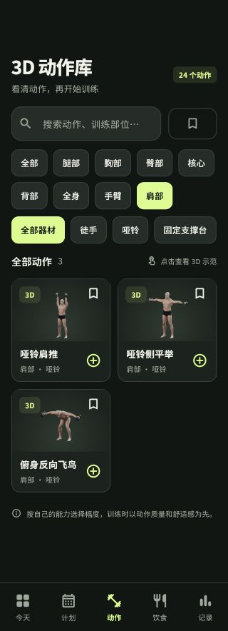
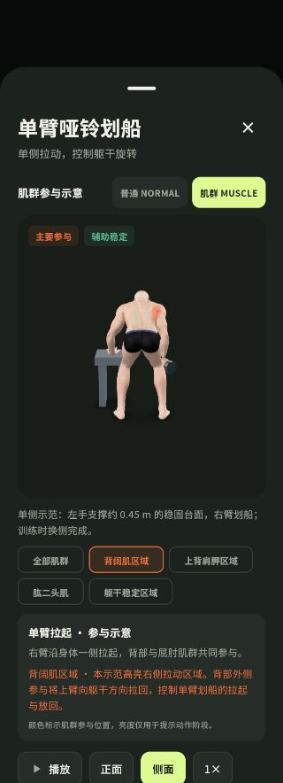

# 24 个动作扩充交付

2026-09-28。动作库由 8 个扩充为 24 个，新增 16 个独立动画、对应缩略图和肌群参与说明，已接入 Flutter 动作库与跟练组件。原有 8 个模型和缩略图相对本次开始时的快照保持不变。

## 新增动作

| 分类 | 动作 |
| --- | --- |
| 胸部 | 跪姿俯卧撑、上斜俯卧撑、哑铃地板卧推 |
| 肩部 | 哑铃肩推、哑铃侧平举、俯身反向飞鸟 |
| 背部与髋部 | 单臂哑铃划船、哑铃罗马尼亚硬拉 |
| 下肢 | 相扑深蹲、分腿蹲、侧弓步、站姿提踵 |
| 核心 | 死虫式、鸟狗式、侧平板支撑 |
| 全身 | 低冲击开合步 |

全部模型有独立的 6 秒演示片段。动作库共 80 个肌群区域实例，支持普通/肌群模式、部位选择、阶段说明和播放控制。单臂划船的主要拉动区域限定于右侧，左手使用实体支撑台；上斜俯卧撑也显示实际支撑台。静态侧平板保持稳定亮度。单侧演示明确提示换侧。

动作搜索、肩部分类、器材筛选、收藏、加入计划、替换和完成记录均覆盖新动作。组合器材按组成部分筛选；需要支撑台的动作不会在未确认可用器材时进入自动推荐。推荐按近期动作使用情况轮换，保留原计划和既有记录。

## 交付入口

- App：<http://127.0.0.1:8879/>
- 全动作对照页：<http://127.0.0.1:8879/exercise-review.html>
- 运行模型：`assets/models/athlete_<id>.glb`
- 可编辑文件：`../characters/05_24动作肌群库/`，共 24 个含肌群层的 Blender 场景、使用说明及校验清单。
- 具体动作依据与参与区域解释：[expanded-muscle-guidance.md](expanded-muscle-guidance.md)。

## 验证

- Flutter 测试 65/65，通过真实资源 manifest、计划保存载入、动作替换、推荐与相机边界检查；Dart 静态分析无问题。
- JavaScript 测试 21/21；肌群蒙版 Python 测试 4/4。
- 新增 16 个基准 GLB 均重新导入 Blender，每个采样 361 个时刻，检查骨长、关节衔接、地面/台面支撑、循环闭合、哑铃附着和动作特有轨迹。负向控制能检出支撑滑移、关节断开与冻结动作。
- 最终 24 个肌群 GLB 的结构验证通过；24 个动画轨道指纹不同；原 8 个资源哈希保持不变。见 [expanded-24-inventory.json](expanded-24-inventory.json) 和 [all-exercise-muscles-verification.json](all-exercise-muscles-verification.json)。
- Web 发布目录的 24 个 GLB、24 张缩略图、目录、控制器和对照页共 51 个文件与源文件逐字节一致，见 [expanded-24-build-sync.json](expanded-24-build-sync.json)。最终 Web 构建通过。
- App 窄屏实际查看了 24 动作总数、肩部 3 项、支撑台 2 项筛选，以及肩推、单臂划船和死虫式显示；死虫式暂停后切换普通/肌群模式仍保持暂停。浏览器控制台未捕获错误。
- 新增动作的离线关键姿势图已审阅，独立代码复核未发现确认的 P1/P2 问题。上、下肢细节分别见 [expanded-upper-motion.md](expanded-upper-motion.md) 和 [expanded-lower-motion.md](expanded-lower-motion.md)。

当前浏览器中的旧对照页标签停留在错误页面，自动化工具拒绝绑定该内部页面，因此本轮对照页采用构建与资源检查；实际浏览器验证在已可正常使用的 App 页面完成。没有绕过浏览器限制。

## 画面记录

## 验证边界

这些是依据动作资料制作的参考动画，尚未经过真人教练逐项验收。几何与界面检查不能证明动作对每位使用者都适用。颜色表示肌群参与位置，亮度用于提示阶段，不是肌电、真实受力值或受力百分比。实体 iOS/Android 设备的性能及 WebView 显示尚未测试。
